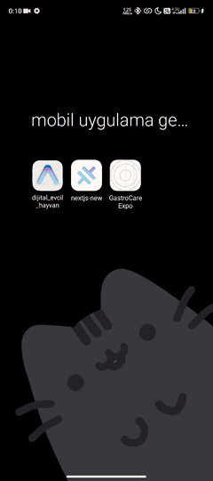

<div align="center">


# Digital Pet


<p>
  
  
  
</p>

<a href="#-english"><b>🇬🇧 English</b></a> · <a href="#-türkçe"><b>🇹🇷 Türkçe</b></a>

</div>

<br>

<table align="center">
  <tr>
    <td align="center" width="25%"><br><b>Your pet</b><br><sub>feed · play · sleep</sub></td>
    <td align="center" width="25%"><br><b>Live stats</b><br><sub>hunger · joy · energy</sub></td>
    <td align="center" width="25%"><br><b>Levels</b><br><sub>XP & badges</sub></td>
    <td align="center" width="25%"><br><b>APK</b><br><sub>on Releases</sub></td>
  </tr>
</table>

##  Demo

<div align="center">
  <br><sub>Excerpt from the demo video (3× speed)</sub><br><a href="https://youtube.com/shorts/kv0gGIet9II"></a>
</div>

---

## 🇬🇧 English

> **Course:** Mobile App Development · Week 4 assignment

###  About the Project
A fun digital pet app built with React Native and Expo. Users can feed their pet, play with it and follow its growth.

###  Features
- **Splash screen:** Custom animated launch screen.
- **Pet interaction:** Feeding, playing and sleeping mechanics.
- **Stat tracking:** Real-time hunger, happiness and energy levels.
- **Level system:** Earn experience points to level up and unlock achievements.
- **Settings:** Sound on/off and notification preferences.

###  Getting Started
1. Clone the repository:
   ```bash
   git clone https://github.com/huseyinbaranisik/mobile_dev_week_4_Digital_Pet.git
   ```
2. Go to the project folder:
   ```bash
   cd mobile_dev_week_4_Digital_Pet
   ```
3. Install dependencies:
   ```bash
   npm install
   ```
4. Start the app:
   ```bash
   npx expo start
   ```

###  Tech Stack
- **React Native** — mobile app framework
- **Expo** — development toolkit
- **JavaScript** — programming language

###  Download the APK
A testable APK is available on the [Releases](https://github.com/huseyinbaranisik/mobile_dev_week_4_Digital_Pet/releases) page. A user-experience report (`kullanıcı_deneyimi.pdf`) and a demo video are also in the repo.

> [!TIP]
> **[📺 Watch the app demo video](https://youtube.com/shorts/kv0gGIet9II)**

---

## 🇹🇷 Türkçe

> **Ders:** Mobil Uygulama Geliştirme · 4. hafta ödevi

###  Proje Hakkında
Bu proje, React Native ve Expo kullanılarak geliştirilmiş eğlenceli bir dijital evcil hayvan uygulamasıdır. Kullanıcılar evcil hayvanlarını besleyebilir, onlarla oyun oynayabilir ve gelişimlerini takip edebilir.

###  Özellikler
- **Giriş Ekranı (Splash Screen):** Özel animasyonlu açılış ekranı.
- **Evcil Hayvan Etkileşimi:** Besleme, oyun oynama ve uyutma mekanikleri.
- **İstatistik Takibi:** Açlık, mutluluk ve enerji seviyelerinin gerçek zamanlı takibi.
- **Seviye Sistemi:** Deneyim puanı kazanarak seviye atlama ve başarımlar.
- **Ayarlar:** Ses açma/kapama ve bildirim tercihleri.

###  Başlangıç
1. Bu depoyu klonlayın:
   ```bash
   git clone https://github.com/huseyinbaranisik/mobile_dev_week_4_Digital_Pet.git
   ```
2. Proje dizinine gidin:
   ```bash
   cd mobile_dev_week_4_Digital_Pet
   ```
3. Bağımlılıkları yükleyin:
   ```bash
   npm install
   ```
4. Uygulamayı başlatın:
   ```bash
   npx expo start
   ```

###  Kullanılan Teknolojiler
- **React Native** — mobil uygulama çatısı
- **Expo** — geliştirme araç seti
- **JavaScript** — programlama dili

###  APK İndir
Uygulamanın test edilebilir APK sürümüne [Releases](https://github.com/huseyinbaranisik/mobile_dev_week_4_Digital_Pet/releases) sayfasından ulaşabilirsiniz. Kullanıcı deneyimi raporu (`kullanıcı_deneyimi.pdf`) ve demo videosu da repoda bulunur.

> [!TIP]
> **[📺 Uygulama demo videosunu izle](https://youtube.com/shorts/kv0gGIet9II)**

---

Developed by / Geliştiren: [Hüseyin Baran Işık](https://github.com/huseyinbaranisik)


<br>

<div align="center">
  
  <sub>Made by <a href="https://github.com/huseyinbaranisik">Hüseyin Baran Işık</a> · Animated emojis: <a href="https://github.com/Tarikul-Islam-Anik/Animated-Fluent-Emojis">Animated Fluent Emojis</a></sub>
</div>
